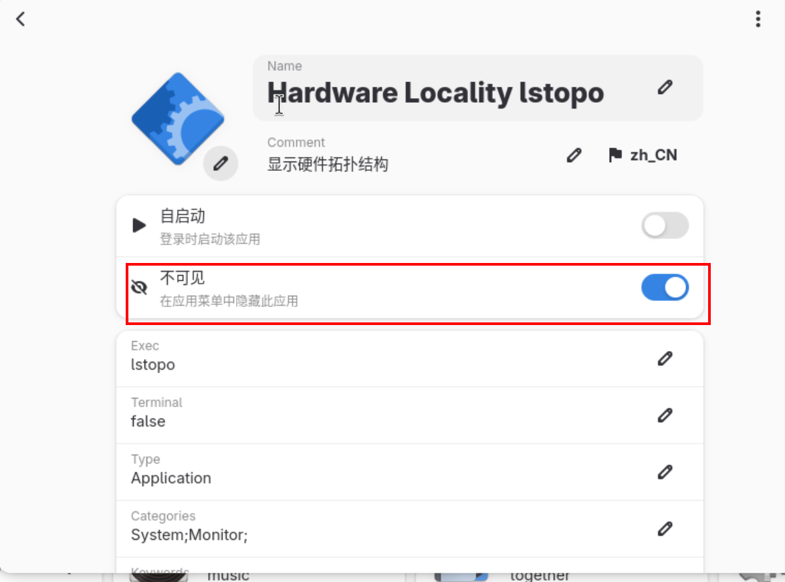

# GNOME

## 安装 GNOME

1. 基础安装

   安装 `malcontent`，避免缺少家长控制后台时，受影响版本的 GNOME 设置无法加载「应用」列表。

   ```sh
   sudo pacman -S \
     baobab \
     gdm \
     gnome-backgrounds \
     gnome-calculator \
     gnome-calendar \
     gnome-characters \
     gnome-clocks \
     gnome-color-manager \
     gnome-connections \
     gnome-control-center \
     gnome-disk-utility \
     gnome-font-viewer \
     gnome-keyring \
     gnome-logs \
     gnome-menus \
     gnome-remote-desktop \
     gnome-session \
     gnome-settings-daemon \
     gnome-shell \
     gnome-system-monitor \
     gnome-text-editor \
     gnome-user-share \
     grilo-plugins \
     gst-thumbnailers \
     gvfs \
     gvfs-afc \
     gvfs-dnssd \
     gvfs-goa \
     gvfs-gphoto2 \
     gvfs-mtp \
     gvfs-nfs \
     gvfs-onedrive \
     gvfs-smb \
     gvfs-wsdd \
     loupe \
     malcontent \
     nautilus \
     papers \
     rygel \
     sushi \
     xdg-desktop-portal-gnome \
     xdg-user-dirs-gtk
   ```

2. 可选安装

   终端和软件商店按需安装

   ```sh
   sudo pacman -S bazaar 或 sudo pacman -S gnome-software
   sudo pacman -S gnome-console 或 sudo pacman -S gnome-terminal 或 sudo pacman -S ghostty
   ```

3. 补充安装

   ```
   sudo pacman -S gnome-tweaks seahorse file-roller nm-connection-editor
   ```

   - `seahorse`：密码和密钥
   - `file-roller`：归档管理器
   - `nm-connection-editor dnsmasl` ：高级网络设置

4. 隐藏不需要的应用图标

   隐藏 lstopo、qv4l2、qvidcap、Vim 和家长控制的图标。这里只修改当前用户的启动器，保留家长控制后台供 GNOME 设置使用。

   ```sh
   applications="${XDG_DATA_HOME:-$HOME/.local/share}/applications"
   mkdir -p "$applications"
   
   for app in lstopo qv4l2 qvidcap vim org.freedesktop.MalcontentControl; do
     src="/usr/share/applications/$app.desktop"
     dst="$applications/$app.desktop"
   
     if [ -f "$src" ]; then
       cp "$src" "$dst"
       sed -i '/^NoDisplay=/d; /^\[Desktop Entry\]$/a NoDisplay=true' "$dst"
     fi
   done
   ```

5. 文件管理器增强

   ```
   sudo pacman -S gst-libav icoextract python-pillow nautilus-image-converter
   ```

   - `gst-plugins-base gst-plugins-good gst-libav` ：这些让你可以预览视频信息（前两个在前面已经作为依赖安装进来了）。
   - `icoextract` `python-pillow` ：exe 缩略图。
   - `nautilus-image-converter` ：右键方便调整图片大小或者旋转。

5. 开启桌面

   ```
   sudo systemctl enable --now gdm
   ```

## 其他设置

1. 隐藏不需要的图标

   `Bazaar` 或者 `GNOME 应用商店` 安装 `Pins` 来隐藏不需要的软件图标：

   

2. 文档管理器中右键从此处打开终端

   适用于 `Ghostty` 等非默认终端。

   ```
   yay -S nautilus-open-any-terminal
   ```

   ```
   gsettings set com.github.stunkymonkey.nautilus-open-any-terminal terminal custom
   gsettings set com.github.stunkymonkey.nautilus-open-any-terminal custom-local-command 'ghostty --working-directory=%s'
   ```

3. 修改 GNOME 默认终端

   当前 GNOME 已将旧终端 schema 中的 `exec`、`exec-arg` 标记为“弃用且忽略”（[官方说明](https://github.com/GNOME/gsettings-desktop-schemas/blob/master/schemas/org.gnome.desktop.default-applications.gschema.xml.in)）。方法一、二仅保留作旧版参考；当前版本使用方法三。

   - 方法一：dconf-editor（已过期）

     ```
     sudo pacman -S dconf-editor
     ```

     `org.gnome.desktop.applications.terminal` 里的 `exec` 取消`使用默认值`，自定义值填 `ghostty`，`exec-arg` 同理，自定义值改成 `-e`。这么写是因为别的程序调用 ghostty 运行命令时需要通过 `-e` 参数把命令传给 `ghostty`。

   - 方法二：gsettings 命令（已过期）

     ```
     gsettings set org.gnome.desktop.default-applications.terminal exec 'ghostty'
     gsettings set org.gnome.desktop.default-applications.terminal exec-arg '-e'
     ```

     读取方法二保存的旧键（只能确认值已保存，不能证明默认终端生效）：

     ```
     gsettings get org.gnome.desktop.default-applications.terminal exec
     gsettings get org.gnome.desktop.default-applications.terminal exec-arg
     ```

     输出应该为：

     ```
     ‘ghostty’
     ‘-e’
     ```

   - 方法三：xdg-terminal-exec（当前推荐）

     GIO 会优先调用 `xdg-terminal-exec`，由它根据用户偏好选择终端。该工具适用于 GNOME Wayland 会话，终端窗口使用的图形后端由 Ghostty 自行处理。

     安装工具（Ghostty 已在前面的终端安装步骤中安装）：

     ```bash
     sudo pacman -S --needed xdg-terminal-exec
     ```

     **使用登录 GNOME 的普通用户**编辑配置，不要用 `sudo`，以免写入 root 的配置目录：

     ```bash
     mkdir -p ~/.config
     vim ~/.config/gnome-xdg-terminals.list
     ```

     将 Ghostty 的应用标识放在第一个有效条目；已有其他终端候选可保留在后面，已有 Ghostty 注释示例则去掉注释并移至首位：

     ```text
     com.mitchellh.ghostty.desktop
     ```

     `gnome-xdg-terminals.list` 是 GNOME 专用偏好文件，每行一个 `.desktop` 标识，按顺序选择首个可用终端，优先级高于通用的 `xdg-terminals.list`。

     验证 GNOME 环境下实际选中的终端，无需启动终端窗口：

     ```bash
     XDG_CURRENT_DESKTOP=GNOME xdg-terminal-exec --print-id
     ```

     预期输出：

     ```text
     com.mitchellh.ghostty.desktop
     ```

     该设置作用于通过 GIO 或 `xdg-terminal-exec` 请求终端的应用；Nautilus 右键终端仍使用上一节扩展的独立配置。更多说明见 [xdg-terminal-exec 配置文档](https://github.com/Vladimir-csp/xdg-terminal-exec#configuration)。